# GenomeMaker - Coral Genome Assembly & Annotation Pipeline 
**Not final**

[](https://github.com/ColinL1/GenomeMaker/releases)
[](https://www.nextflow.io/)
[](https://www.nextflow.io/docs/latest/dsl2.html)

[Nextflow DSL2](https://www.nextflow.io/docs/latest/dsl2.html) pipeline for *de novo* assembly and annotation of coral (Scleractinia) genomes from Oxford Nanopore Technologies (ONT) long reads, from raw reads to an NCBI-ready submission.

## Table of Contents

- [GenomeMaker - Coral Genome Assembly \& Annotation Pipeline](#genomemaker---coral-genome-assembly--annotation-pipeline)
  - [Table of Contents](#table-of-contents)
  - [Pipeline Overview](#pipeline-overview)
  - [Installation Requirements](#installation-requirements)
    - [Tools set up outside the containers](#tools-set-up-outside-the-containers)
    - [BRAKER4 setup](#braker4-setup)
  - [Reference Data and Databases](#reference-data-and-databases)
  - [Quick Start](#quick-start)
    - [1. Clone the repository](#1-clone-the-repository)
    - [2. Stub test (no computation)](#2-stub-test-no-computation)
    - [3. De novo run](#3-de-novo-run)
    - [4. Starting from an existing assembly](#4-starting-from-an-existing-assembly)
    - [Profiles](#profiles)
  - [Parameter Reference](#parameter-reference)
    - [Core inputs](#core-inputs)
    - [Assembly and filtering](#assembly-and-filtering)
    - [Annotation](#annotation)
    - [Executor](#executor)
  - [Multi-Assembler Comparison](#multi-assembler-comparison)
  - [Stage Toggles and Dependencies](#stage-toggles-and-dependencies)
  - [Contamination Screens](#contamination-screens)
  - [Release Curation](#release-curation)
  - [Output Structure](#output-structure)
    - [Release curation folder](#release-curation-folder)
  - [License](#license)

---

## Pipeline Overview

Two ways in, two ways out:

- **Mode**: from ONT reads (stages 00 → 01 → 02 → 02b), or from an existing assembly with `--input_assembly` (00 → 02c). Both join at the mitochondrial-contig check; everything after is the same.

```mermaid
flowchart LR
    subgraph MODE_READS ["Mode: from reads"]
        R00["00 Read preprocessing"] --> R01["01 k-mer genome size"] --> R02["02 Assemblers"] --> R02b["02b Ranking"]
    end
    subgraph MODE_ASM ["Mode: --input_assembly"]
        A00["00 Read preprocessing"] --> A02c["02c QC of the assembly"]
    end

    R02b --> M05["05 MitoHiFi: mito contigs removed"]
    A02c --> M05
    M05 -.-> MITO["05 Mitogenome<br/>side branch"]

    M05 --> P04["04 Medaka + polish QC gate<br/><i>run_polish</i>"]
    P04 --> F03["03 BlobToolKit split<br/>host | symbiont bin | other"]
    F03 --> F03b["03b purge_dups on the host bin + purge QC gate<br/><i>run_purge_dups</i>"]
    F03b --> LF["Length filter >= 200 bp"]
    LF --> S03c["03c Contamination screens<br/>last step that changes bases<br/><i>run_screens</i>"]
    S03c --> SC03d["03d RagTag <i>scaffold_reference</i><br/>then sort / rename"]
    SC03d --> AN06["06 Repeats"] --> AN07["07 Gene models + 07c refinement"] --> AN08["08 Functional annotation"]

    AN08 --> SUM09["09 Summary + MultiQC<br/>run overview, gates, methods"]
    AN08 --> REL10["10 Product curation, table2asn, release QC gate<br/><i>run_release</i>"]
    REL10 --> SUM09
    MITO -.-> SUM09
    F03 -. symbiont bin .-> SUM09

    SUM09 --> FINAL[("final/<br/>automatic strategy, always written")]
    SUM09 --> RELDIR[("release_curation/#lt;release_name#gt;/<br/>with release curation")]
    REL10 --> RELDIR

    classDef optional stroke-dasharray: 5 5
    class REL10,RELDIR optional
```

- **Strategy**: *automatic* (default): every stage through functional annotation, written to `final/`; or *automatic + release curation* (`--run_release true`): the same, plus rule-based curation and the NCBI submission in `release_curation/<release_name>/`. `final/` is written in both strategies.



Dashed boxes run only with `--run_release true`. Switches in *italics* skip a step; the assembly then passes through unchanged.

| Stage | Module | Description |
|-------|--------|-------------|
| **00** | `00_preprocess_reads` | Porechop adapter removal, FastQC/NanoPlot/NanoStat QC, chopper read sets (assembly, polishing, high-quality k-mer reads), optional symbiont read removal (chopper `--contam`) |
| **01** | `01_kmer_genome_size` | Meryl k-mer database and histogram, GenomeScope 2 genome size estimate |
| **02** | `02_multi_assembler` | Parallel assembly with NECAT, Flye, hifiasm and/or Raven; BUSCO, gfastats and QUAST per assembly |
| **02b** | `02b_select_best_assembly` | Ranks the assemblies: size outliers last; within the BUSCO tie band the assembly closest to the expected size wins; N50 breaks a size tie |
| **02c** | `02c_input_assembly_qc` | Replaces 01-02b when an existing assembly is given with `--input_assembly` |
| **05** | `05_mitogenome` | MitoHiFi finds the mito contig in the selected assembly; it is removed from the nuclear assembly. The mitogenome itself: MitoHiFi contig + Medaka (ONT) or GetOrganelle (Illumina DNA), rotation, Liftoff and MITOS2, adaptor/vector screens |
| **04** | `04_assembly_polish` | Medaka on the contigs; Merqury QV and BUSCO before and after; the unpolished contigs go on if polishing makes them worse |
| **03** | `03_assembly_filtering` | BlobToolKit split (BLASTN vs nt, DIAMOND vs UniProt, ONT coverage, BUSCO) on the unpurged contigs: host, symbiont bin, other |
| **03b** | `03b_purge_dups` | purge_dups on the host bin; the purge QC gate (BUSCO before/after) stops the run when it removes BUSCO genes; length filter |
| **03c** | `03c_screens` | NCBI contamination screens: FCS-adaptor, VecScreen (UniVec), FCS-GX; unclear hits are reviewed before actions are applied |
| **03d** | `03d_scaffold` | Optional RagTag scaffolding, then sort and rename (`scaffold_1..N`); with RagTag, the scaffold name map |
| **06** | `06_repeats` | RepeatModeler + EDTA library, RepeatClassifier for unknown families, RepeatMasker soft-masking, barrnap rRNA |
| **07** | `07_structural_annotation` | RNA-seq trimming and STAR mapping, BRAKER4 gene prediction, tRNAscan-SE, Infernal/Rfam ncRNAs, StringTie, AGAT merge and GFF3 validation, compleasm and OMArk |
| **07c** | `07c_annotation_refine` | Gene-model refinement: UTRs, gene membership, tRNA/ncRNA filters, haplotig and gap-fusion scans, isoform filter, protein identity check |
| **08** | `08_functional_annotation` | InterProScan, eggNOG-mapper, Phobius, funannotate annotate |
| **10** | `10_release` | Release curation (optional): product-name curation, table2asn NCBI submission, release QC gate, release folder |
| **09** | `09_summary` | summary.tsv, methods, software versions and the integrated MultiQC report; the `final/` folder |

---

## Installation Requirements

| Requirement | Version | Notes |
|-------------|---------|-------|
| [Nextflow](https://www.nextflow.io/) | >= 24.04.0 | `resourceLimits` in the binac2 profile needs 24.04 |
| [Apptainer](https://apptainer.org/) / Singularity | >= 1.1.0 | Used by the `binac2` and `local` profiles; also needed on `PATH` for the FCS images and BRAKER4 |
| [Conda](https://docs.conda.io/) / Mamba | >= 22.0 | `conda` profile, and the Snakemake environment that runs BRAKER4 |
| [Git](https://git-scm.com/) | any | For cloning the repository |

```bash
# Install Nextflow
conda install -c bioconda nextflow
# or
curl -s https://get.nextflow.io | bash

nextflow -v
```

### Tools set up outside the containers

| Tool | Parameter | Notes |
|------|-----------|-------|
| BRAKER4 | `--braker4_dir`, `--braker4_snakemake_env` | Not in the repository: set it up once, see [BRAKER4 setup](#braker4-setup) |
| BRAKER4 on SLURM | `--braker4_executor slurm` | Each BRAKER4 rule becomes its own SLURM job (`--braker4_slurm_partition`, account `--project`, `--braker4_slurm_jobs`, per-rule limits `--braker4_slurm_cpus`, `--braker4_slurm_mem_mb`, `--braker4_slurm_runtime`); `--braker4_snakemake_env` needs `snakemake-executor-plugin-slurm`. Default `local`: all rules in one job |
| NECAT | `--necat_path_bin` | Only when `necat` is in `--assemblers` |
| Phobius | `--phobius_dir` | Licence-restricted; install from the licensed tarball, or `--run_phobius false` |
| InterProScan data | `--interproscan_data` | Must match the release of `--interproscan_container` (default `interpro/interproscan:5.73-104.0`) |
| FCS-adaptor / FCS-GX | `--fcs_adaptor_image`, `--fcs_gx_image` | NCBI `.sif` images, run with `apptainer exec` |
| table2asn | `--table2asn` | NCBI Linux binary, for the release stage only |

### BRAKER4 setup

Structural annotation runs [BRAKER4](https://github.com/Gaius-Augustus/BRAKER4) (a Snakemake
workflow) from a checkout and a Snakemake env. Both are gitignored, so a fresh clone does not have
them. The defaults expect them inside the pipeline folder; from the pipeline folder:

```bash
git clone https://github.com/Gaius-Augustus/BRAKER4.git .braker4/BRAKER4
git -C .braker4/BRAKER4 checkout f087ed0          # the tested commit (v0.5.0-beta-19)
mamba env create -p .conda_envs/braker4_snakemake -f assets/braker4_snakemake_env.yml
```

Elsewhere: set `--braker4_dir` (the folder with `Snakefile`) and `--braker4_snakemake_env` (the env
folder with `bin/snakemake`). With `--braker4_executor slurm` the env also needs
`snakemake-executor-plugin-slurm` (see `assets/braker4_snakemake_env.yml`). The run stops at start-up
when structural annotation is on and either is missing. BRAKER4 pulls its own containers on the
first run.

---

## Reference Data and Databases

Most defaults in `nextflow.config` point into a `config/` folder in the pipeline directory. That folder holds site-specific data and is **not part of the repository**: create it, or pass the paths on the command line or in your own config file.

| Parameter | Content |
|-----------|---------|
| `--blast_db` | Folder holding the `core_nt` BLAST database (`core_nt.nal`, `core_nt.00.*`, ...); `new_taxdump/` next to it unless `--blast_taxdump` is set |
| `--diamond_db` | DIAMOND database of UniProt reference proteomes |
| `--busco_offline_dir` | BUSCO lineage datasets (null = download) |
| `--protein_refs` | Protein evidence for BRAKER4 (e.g. OrthoDB Metazoa) |
| `--rnaseq_dir` | Directory of paired-end RNA-seq FASTQ files |
| `--trimmomatic_adapters` | Adapter FASTA for RNA-seq trimming |
| `--funannotate_db`, `--eggnog_db` | funannotate and eggNOG-mapper databases |
| `--omamer_db` | OMAmer database for OMArk |
| `--rfam_cm`, `--rfam_clanin`, `--rfam_family` | Rfam covariance models (cmpress'd), clan file and family table |
| `--mito_ref` | Related mitogenome: MitoHiFi finds the mito contig with it (mitogenome, and its removal from the nuclear assembly); also read recruitment |
| `--mito_annot_ref_fasta`, `--mito_annot_ref_gff` | Annotated related mitogenome for Liftoff (`false` = MITOS2 only) |

---

## Quick Start

### 1. Clone the repository

```bash
git clone https://github.com/ColinL1/GenomeMaker.git
cd GenomeMaker
```

### 2. Stub test (no computation)

```bash
nextflow run . -stub -profile test
```

Runs every process in stub mode, including the optional stages and the release, with the dummy inputs in `assets/test/`. It checks the workflow graph and channel wiring without tools, data or containers.

### 3. De novo run

```bash
nextflow run main.nf -profile binac2 \
    --ont_raw_reads data/ONT_raw_reads.fastq.gz \
    --outdir results \
    --species_name Porites_sp \
    --run_screens false
```

The contamination screens are on by default and need their databases (see [Contamination Screens](#contamination-screens)); turn them off as above, or provide them.

### 4. Starting from an existing assembly

```bash
nextflow run main.nf -profile binac2 \
    --input_assembly assembly.fasta \
    --ont_raw_reads data/ONT_raw_reads.fastq.gz \
    --outdir results
```

This skips stages 01-02b. ONT reads are still required for polishing, BlobToolKit coverage, purge_dups and the mitogenome. An assembly that is already curated can skip steps: `--run_polish false`, `--run_purge_dups false`.

### Profiles

| Profile | Executor | Software |
|---------|----------|----------|
| `binac2` | SLURM (`--project` sets the account) | Apptainer, cached in `--apptainer_cache_dir` |
| `local` | local | Apptainer |
| `conda` | local | conda/mamba environments (for quick local iteration) |
| `test` | local | none (use with `-stub`) |

Per-process CPUs, memory and time are set in `process_resource.config`; adjust them there for another cluster. Failed tasks are retried with more resources only for out-of-memory and walltime exit codes (`--max_retries`, default 3).

---

## Parameter Reference

The full list, with comments, is in `nextflow.config`. The most used ones:

### Core inputs

| Parameter | Default | Description |
|-----------|---------|-------------|
| `--ont_raw_reads` | | ONT reads (FASTQ, gzipped) |
| `--input_assembly` | `null` | Existing assembly; skips k-mer sizing and assembly |
| `--outdir` | `results` | Output directory |
| `--species_name` | `Porites_sp` | Name used in output file names |
| `--symbiont_refs` | `null` | Symbiont reference genome(s) for read removal (comma-separated) |
| `--genome_size` | `null` | Haploid genome size in bp; null = GenomeScope 2 estimate (one of the two is required from reads) |
| `--version` | `1.0` | Version of the assembly + annotation (GFF3 file name) |
| `--busco_lineage` | `anthozoa_odb12` | BUSCO lineage for all assembly QC and BRAKER4 |

### Assembly and filtering

| Parameter | Default | Description |
|-----------|---------|-------------|
| `--assemblers` | `['flye','hifiasm','raven']` | Any of `necat`, `flye`, `hifiasm`, `raven` |
| `--busco_tie_band` | `2.0` | BUSCO completeness difference (percentage points) treated as a tie; within it the assembly closest to the expected size wins |
| `--assembly_size_tolerance` | `0.30` | Deviation from the expected size before an assembly is ranked last |
| `--mito_contig_max_ratio` | `3` | MitoHiFi-listed contigs longer than this many times the reference mitogenome stay in the nuclear assembly |
| `--purge_dups_lower`, `--purge_dups_transition`, `--purge_dups_upper` | `null` | calcuts cutoffs; null = automatic |
| `--purge_busco_tolerance` | `1.0` | Purge QC gate: BUSCO completeness drop (pp) that stops the run |
| `--min_contig_length` | `200` | Sequences shorter than this are removed after purging |
| `--taxon_id` | `46719` | NCBI taxid of the organism (BlobToolKit dataset and FCS-GX `--tax-id`) |
| `--host_taxon_name` / `--symbiont_taxon_name` | `Cnidaria` / `Symbiodiniaceae` | BlobToolKit taxa kept as host and symbiont |
| `--auto_filter` | `true` | Automatic best-hit taxon filter |
| `--filter_json` | `null` | Manual selection exported from the BlobToolKit Viewer, used instead of the automatic filter |
| `--scaffold_reference` | `null` | Reference genome for RagTag; null = no scaffolding |
| `--medaka_model` | `null` | Medaka model; null = read from the ONT read headers |

### Annotation

| Parameter | Default | Description |
|-----------|---------|-------------|
| `--funannotate_busco_db` | `metazoa` | BUSCO set inside the funannotate database |
| `--related_proteomes` | `null` | Folder of related-species protein FASTA files; enables the gap-fusion split and the isoform filter |
| `--n_chromosome_scaffolds` | `null` | Number of chromosome-scale scaffolds (`scaffold_1..N` after sorting); needed by `--run_haplotig_scan` |
| `--run_haplotig_scan` | `false` | Tag genes with a near-identical copy on a chromosome scaffold |
| `--transcript_edits` | `null` | TSV of manual transcript edits (drop a transcript or replace its CDS) |
| `--rm_libraries` | `null` | RepeatMasker `Libraries/` folder with Dfam partitions for RepeatClassifier |

### Executor

| Parameter | Default | Description |
|-----------|---------|-------------|
| `--project` | `null` | SLURM account |
| `--publish_mode` | `copy` | Publish mode for results |
| `--publish_mode_intermediate` | `symlink` | Publish mode for large intermediates; use `copy` if the work dir is purged |
| `--max_retries` | `3` | Retries for out-of-memory and walltime failures |
| `--email` / `--email_on_failure` | `null` / `false` | Completion e-mail |

---

## Multi-Assembler Comparison

```bash
nextflow run main.nf -profile binac2 \
    --ont_raw_reads data/ONT_raw_reads.fastq.gz \
    --assemblers 'necat,flye,raven' \
    --outdir results
```

1. Each assembler runs independently.
2. Every assembly gets BUSCO, gfastats and QUAST.
3. A comparison table (TSV and JSON) and a ranking table are written to `02_assembly/`.
4. The top-ranked assembly continues downstream; all assemblies are published.

| Assembler | Notes | Default memory |
|-----------|-------|----------------|
| `necat` | ONT reads; needs a local NECAT install | 256 GB |
| `flye` | Runs with `--meta` by default (`--flye_meta`) | 256 GB |
| `hifiasm` | PacBio HiFi or high-accuracy ONT | 256 GB |
| `raven` | Fast, lower memory | 128 GB |

---

## Stage Toggles and Dependencies

| Parameter | Default | Effect |
|-----------|---------|--------|
| `--run_genomescope` | `true` | GenomeScope 2 size estimate (ignored with `--genome_size`) |
| `--run_porechop` | `true` | Porechop adapter removal |
| `--run_symbiont_filter` | `true` | Remove reads matching `--symbiont_refs` |
| `--run_mitogenome` | `true` | Mitogenome, and the removal of mito contigs from the nuclear assembly (needs `--mito_ref`) |
| `--run_polish` | `true` | Medaka polishing of the contigs |
| `--run_polish_qc` | `true` | Polish QC gate (QV/BUSCO before and after); also the final Merqury QV |
| `--run_blobtools` | `true` | BlobToolKit host/symbiont split |
| `--run_purge_dups` | `true` | purge_dups on the host bin, with its QC gate |
| `--run_assembly_checkpoints` | `true` | BUSCO + gfastats after the split (always on with purge_dups: the purge gate needs it) |
| `--run_screens` | `true` | NCBI contamination screens |
| `--run_repeats` | `true` | Repeat library and soft-masking |
| `--run_structural_annotation` | `true` | Gene prediction (needs `--run_repeats`, `--rnaseq_dir` and `--protein_refs`) |
| `--run_compleasm` | `true` | compleasm on the final assembly |
| `--run_functional_annotation` | `true` | Functional annotation (needs structural annotation) |
| `--run_release` | `false` | Release curation: NCBI submission and release folder (needs structural and functional annotation) |

A stage that is switched on but cannot run stops the run at start-up, before any task: a missing `--rnaseq_dir`, `--protein_refs` or `--mito_ref`, structural annotation without repeats, functional annotation without structural annotation, the release curation without annotation, no expected genome size for the assembler ranking, the haplotig scan without `--n_chromosome_scaffolds`, and missing screen or NCBI settings. Nothing is skipped silently.

The automatic decisions (assembler ranking, polish gate, purge gate, mito contigs, length filter, screen actions) are listed in the MultiQC run overview and in the methods (`qc/methods.md`).

---

## Contamination Screens

With `--run_screens true` (default) the purged, length-filtered contigs go through FCS-adaptor, VecScreen and FCS-GX before scaffolding; no later step changes a base (RagTag adds gaps, the sort renames; the release QC checks this). Required: `--univec`, `--fcs_gx_db`, `--fcs_adaptor_image`, `--fcs_gx_image` and `--taxon_id` (must be in the GX database). The run checks these at start-up.

Clear-cut hits are applied automatically. Unclear hits (FCS-GX REVIEW, VecScreen Strong/Moderate) stop the run and are listed in `03c_screens/contigs/review/screen_review.tsv`. Decide them in a TSV (`seq`, `start`, `end`, `decision` = `exclude` | `mask` | `keep`, `reason`), pass it with `--screen_decisions`, and resume with `-resume`.

---

## Release Curation

`--run_release true` adds rule-based curation to the automatic run and builds a table2asn submission and a release folder, `release_curation/<release_name>/`. The rules are the same for every genome; their effect differs between genomes, so check the release QC gate and the table2asn tables in the MultiQC report. Required: `--table2asn`, `--ncbi_species` (exactly as in the BioSample), `--locus_tag`, `--ncbi_sbt`, `--ncbi_cmt`, `--bioproject`, `--biosample`, and `--ncbi_isolate` or `--ncbi_strain`. These are checked at start-up.

Useful options:

| Parameter | Description |
|-----------|-------------|
| `--release_name` | Release folder name |
| `--product_draft` | TSV of checked product names (symbol to product), used before the UniProt lookup |
| `--product_cache`, `--uniprot_offline` | Reuse a UniProt lookup cache; offline mode uses only the cache |
| `--symbiont_busco_lineage` | BUSCO lineage for the symbiont bin |
| `--ncbi_linkage_evidence` | Scaffold-gap linkage evidence (default `align-genus` with RagTag) |
| `--qc_expected_lineage`, `--qc_expected_division`, `--qc_chrom_prefix` | Expectations for the release QC checks |

Before the folder is written, the release QC gate checks the models, protein identity, the protein-coding count (funannotate, release GFF3, summary.tsv), scaffold names and the AGP (with RagTag), that the released sequence equals the screened contigs apart from gaps and names, repeat labels, the screens and the table2asn reports. Any failed check stops the run; the results are in `qc/annotation_qc.tsv` and in the MultiQC report.

---

## Output Structure

The two folders to use are `final/` (always) and, with the release curation, `release_curation/<release_name>/`. Everything else is the per-stage record.

```text
outdir/
├── final/                           # the automatic product (both strategies)
│   ├── genome/                      # <species_name>.fa (soft-masked); scaffold_name_map.tsv with RagTag
│   ├── annotation/                  # GFF3, proteins, CDS, mRNA, annotations.txt (stage 08)
│   ├── repeats/                     # repeats.gff3, RepeatMasker .tbl/.out, classified library
│   ├── mitogenome/                  # sequence and annotation
│   ├── symbiont/                    # symbiont bin of the BlobToolKit split
│   ├── qc/                          # summary.tsv, methods.md, ranking, gate reports, removed contigs, screen actions
│   └── multiqc_report.html
├── release_curation/<release_name>/ # with --run_release (see below)
├── 00_preprocessing/                # read sets and read QC
├── 01_kmer_genome_size/             # meryl, GenomeScope 2
├── 02_assembly/                     # per-assembler output, QC, comparison, selection
├── 05_mitogenome/                   # MitoHiFi, GetOrganelle/ONT polish, final/, nuclear_filter/
├── 04_polishing/                    # Medaka; qc/: BUSCO, Merqury QV, polish gate
├── 03_filtering/                    # BlobDir, host and symbiont assemblies, plots
├── 03b_purge_dups/                  # purged assembly, haplotigs, cutoffs; qc/ purge gate; length_filter/
├── 03c_screens/contigs/             # FCS-adaptor, VecScreen, FCS-GX, review and actions
├── 03d_scaffolding/                 # RagTag scaffolds and AGP; sorted/ final assembly and name map
├── 06_repeats/  07_structural_annotation/  08_functional_annotation/
├── 10_release_curation/             # intermediate release files (with --run_release)
├── summary/
│   ├── multiqc/multiqc_report.html  # integrated report
│   ├── final/summary.tsv  release_curation/summary.tsv
│   └── methods.md, software versions, summary tables
└── pipeline_info/                   # Nextflow timeline, report, trace and DAG
```

### Release curation folder

| Path | Content |
|------|---------|
| `genome/` | Soft-masked, screened scaffolds (the same sequence as `final/genome`); `scaffold_name_map.tsv` with RagTag |
| `annotation/` | GFF3, proteins, CDS and mRNA transcripts, `annotations.txt`, `.gbk` (all consistent with the submission) |
| `annotation/extra/` | High-confidence GFF3 and proteins, `trna_pseudogenes.gff3`, `splits.tsv`, `id_map.tsv`, haplotig and gap candidate lists, `rrna_decisions.tsv` |
| `repeats/` | Repeat GFF3, RepeatMasker `.tbl` and `.out`, classified library |
| `ncbi/` | table2asn `.sqn`, `.val`, `.dr`, `.gbf`, `in.stats` (the mitogenome is in the same `.sqn`) |
| `mitogenome/` | Mitogenome sequence and annotation |
| `qc/` | `annotation_qc.tsv`, `summary.tsv`, refinement and protein-identity reports, product curation, screening reports, BUSCO, symbiont BUSCO, Merqury QV |
| `multiqc_report.html` | The run's MultiQC report: run overview, every stage, release QC, methods |

See [docs/manual_validation.md](docs/manual_validation.md) for the full-data check of the stage order.

---

## License

See the [LICENSE](LICENSE) file for details.
